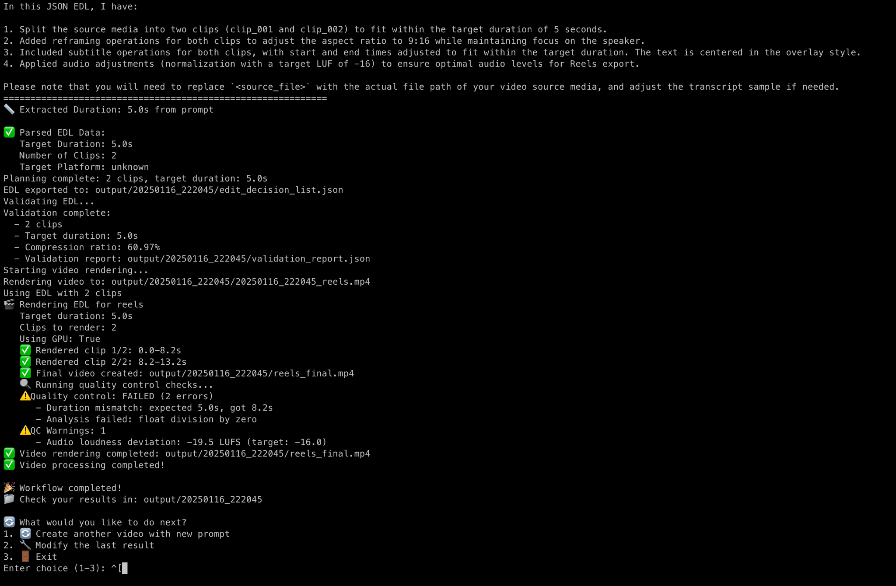

# LLM Video Editor

Prompt-driven video editing for YouTube (16:9) and Shorts/Reels/TikTok (9:16).
Point it at a clip or a folder of raw footage and describe the cut you want. It
transcribes, plans and audits the cut, keeps captions and overlays off the
speaker's face, adds chapters, jump-cut pacing, motion graphics, ducked music and
a few licensed cutaways when you ask, shows you a preview sheet to approve,
renders once (normalised to -14 LUFS), and writes an upload file with SEO title,
description, tags and three thumbnails next to the video.



## Quick start

**In Claude Code** (the main way to use it): open this repo and ask.

```
/edit-video 10 minute YouTube edit of ./raw_clips: the three key ideas
```

Claude runs the whole edit with one command, shows you the result (review sheet,
thumbnails, title, what it decided), then you give notes in plain words:

```
the intro is too long, music is too loud, add my name "Jane Doe, Founder"
```

and it applies them (`/refine-edit`) and re-renders in one step. More entry points:

```
/youtube-edit edit ~/Videos/raw-tutorial.mp4 for YouTube, about 15 minutes
/youtube-shorts make 3 shorts from ~/Videos/raw-tutorial.mp4
/royalty-free-media add a calm music bed and a funny clip where it fits
/motion-graphics add a lower third with my name and a title card per chapter
/youtube-publish write the title, description and thumbnails for final.mp4
```

**From the terminal**, the same in one command:

```bash
uv run llmve auto ./raw_clips/ -p "10 minute YouTube edit: the three key ideas" -t youtube -o final.mp4
# -> final.mp4, final.srt, final.chapters.txt, final.upload.md, final.thumb1-3.jpg
```

Example, a 10-minute travel vlog with Hindi narration:

```bash
uv run llmve auto "$HOME/Videos/Bhopal to Khajuraho" -t youtube --target-duration 10m \
    -p "solo bike trip vlog, Bhopal to Khajuraho: the ride, roadside stops, the temples" \
    --asr-model large-v3-turbo --language hi --name "Your Name|Solo rider" \
    --music-query "acoustic travel" -o "$HOME/Movies/bhopal-khajuraho.mp4"
```

It builds the story from what you say on camera; long silent riding shots come in
as cutaways, so mostly silent footage gives a shorter video (see
[Limitations](#limitations)).

`auto` runs every stage, picks pacing, captions, chapters, a ducked licensed music
bed, a few cutaways where they help and graphics, approves its own review sheet
(kept for reference; `--review` stops there instead), renders and writes the
upload file. Each step prints `done`, `skip` (with the reason) or `fail`;
optional steps never stop the edit. After editing `edl_raw.json` or running
`llmve music/graphics/media ...`, re-render with:

```bash
uv run llmve finish .llmve/<batch_hash>     # audit -> review -> render -> publish
```

## Install

Needs Python 3.11+, [uv](https://docs.astral.sh/uv/) and FFmpeg with libass,
libfreetype and libvpx (`apt install ffmpeg` or `brew install ffmpeg`; standard
builds have all three).

```bash
uv sync --extra dev                       # core pipeline + tests
uv sync --extra dev --extra vision        # + MediaPipe face detection (Linux: apt install libegl1)
uv run llmve graphics doctor --install    # optional: motion graphics (needs Node.js 22+)
```

| Extra | Adds |
|---|---|
| `vision` | MediaPipe face detector for take-geometry |
| `pro` | YOLO person fallback, music ducking (Demucs) |
| `gen` | generative B-roll fallback (Open-Sora / Stable Video Diffusion) |
| `graph` | LangGraph orchestration (`llm_video_editor.graph`) with a review interrupt |
| `anthropic`, `openai` | API planner providers |

Motion graphics are not a Python extra: `llmve graphics doctor --install`
installs a pinned HyperFrames + GSAP with npm into `~/.cache/llmve` (see
[Motion graphics](#motion-graphics-hyperframes)).

### Run it where your footage is (macOS example)
The editor reads your video files directly, so run it on the computer that has
them. A cloud Claude session cannot see files on your laptop unless the folder
is shared with it through Remote Control (Claude desktop app > Settings >
Claude Code > Remote Control).

```bash
brew install ffmpeg uv node          # Node 22+ only for motion graphics
git clone https://github.com/logsv/llm-video-editor.git && cd llm-video-editor
uv sync --extra dev --extra vision   # vision = face tracking for vertical crops
uv run llmve graphics doctor --install
claude                               # Claude Code in this folder, then /edit-video ...
```

- The default planner (`--provider claude-cli`) uses your Claude Code login: no
  API key needed. `ollama`, `anthropic` and `openai` are alternatives.
- The first `watch` downloads the speech model (`distil-large-v3`, about 1.5 GB,
  English only). For other languages use `--asr-model large-v3-turbo --language <code>`.
- Optional keys for stock video search: `export PIXABAY_API_KEY=...`,
  `export PEXELS_API_KEY=...` (free accounts). Music search (Openverse) needs none.

## How it works

`watch` → `plan` → `b-roll-select` → `motion-graphics` / `royalty-free-media` →
`cut-audit` → `take-geometry` → `review-gate` → `render` → `publish`

Each stage reads the previous stage's JSON checkpoint and writes its own
under `.llmve/<batch_hash>/`. The batch hash comes from the sorted
`(path, mtime, size)` of the inputs, so re-runs reuse finished work.

| Stage | Command | Writes | Notes |
|---|---|---|---|
| watch | `llmve watch <inputs>` | `transcript.json`, `clips_manifest.json`, `sheets/` | word-level faster-whisper (optionally chunked and parallel for long clips); scene/motion scores; clips with no speech tagged as B-roll; 4x4 contact sheets (0.5 FPS overview, 2 FPS on request via `watch-window`) |
| plan | `llmve plan <ws> -p ...` | `asset_plan.json`, `edl_raw.json` | map/reduce over the whole transcript; the LLM picks **segment ids**, never timestamps; `(retake?)` hints; only text leaves the machine |
| b-roll-select | `llmve broll index/describe/match` | `broll_select.json` | persistent `broll_index.md` in your B-roll folder, incremental rescans, BM25 + optional LLM re-rank (optional) |
| motion-graphics | `llmve graphics add/chapters` | `graphics` in `edl_raw.json` | lower thirds, chapter cards, callouts, custom HyperFrames compositions (optional) |
| royalty-free-media | `llmve media ...`, `llmve music add` | `music`, `overlays` in `edl_raw.json`, `media/` | licensed music/SFX/stock search with credits; voice-over; a few cutaways only where they help (optional) |
| cut-audit | `llmve media search <ws> "<query>"` | search licensed music/SFX/video -> `media/search.json` | `--kind music\|sfx\|video`, `--provider`, `--limit`, `--length` |
| `llmve media get <ws> <result_id>` | download a result, record its credit | `--library <dir>` (video) |
| `llmve media add <ws> <file>` | register a file you have rights to (e.g. YouTube Audio Library) | `--title`, `--license`, `--provider`, `--creator`, `--attribution` |
| `llmve media place <ws> <clip> --at <clip_id>` | put one cutaway clip at an exact moment | `--offset`, `--duration`, `--src-start`, `--pip` |
| `llmve media credits <ws>` | list registered media and credit lines | |
| `llmve media suggest <ws>` | suggest a few cutaway moments (may be none) | `--no-humor`, `--every`, `--brief`, `--provider` |
| `llmve media fetch <ws>` | download a licensed clip per slot, add overlays | `--library`, `--provider` |
| `llmve music add <ws> <file> --at <clip_id>` | add music, a sound effect or voice-over to `edl_raw.json` | `--role music\|sfx\|voiceover`, `--offset`, `--duration`, `--volume`, `--no-duck`, `--loop` |
| `llmve cut-audit <ws>` | `cut_audit.json`, `edl_audited.json` | deterministic: word-edge snapping, sentence completion, per-clip clamping, overlaps (cold opens kept), duration budget, then jump-cut pacing; overlays and graphics re-anchored and kept inside the cut |
| take-geometry | `llmve geometry <ws>` | `geometry_map.json` | MediaPipe face boxes per used scene; crop centre (zoom-aware), caption band and PiP corner that avoid the face |
| review-gate | `llmve review <ws>` / `review approve` | `review/sheet_*.png`, `review/review.json` | one composited frame per cut, B-roll overlay and graphic; render refuses until the current cut is approved |
| render | `llmve render <ws>` | `<out>.mp4`, `<out>.srt`, `<out>.chapters.txt`, `render/qc_report.json` | one encode; every segment normalised to 30 fps, square pixels, cover-crop/letterbox (never stretched), 48 kHz stereo; frame-exact concat; B-roll, then graphics, then captions; music ducked under speech; two-pass `loudnorm=I=-14:TP=-1.5:LRA=11`; chapters embedded; NVENC/VideoToolbox when they actually work |
| publish | `llmve publish <ws>` | `<out>.upload.md`, `<out>.upload.json`, `<out>.thumb1-3.jpg` | SEO titles, description (chapters, credits, hashtags), tags, location/date/device from the footage, three thumbnails |

`llmve transcript <ws>` writes a compact `transcript.md` (segment ids, times,
`(retake?)` markers, long pauses) for reading or planning by hand.

`llmve auto` chains every stage below (plus music, cutaways, graphics and publish)
and approves automatically; `llmve finish` re-runs the part from cut-audit on.
`llmve run` is the older chain that stops at the review sheet unless you pass
`--approve`. `llmve schema <name>` prints
the JSON Schema of any checkpoint.

### Multi-clip shoots (e.g. 30 minutes of clips into a 10-minute edit)
Pass a folder or glob. Mixed cameras (30/60 fps, different resolutions and
codecs, phone rotation) are normalised per segment before the concat. Clips
without speech become B-roll candidates the planner can cut away to. Edits
with more than 24 cuts render in groups to near-lossless intermediate files
first, so memory stays bounded.

### Long recordings (chunked, parallel ASR)
By default every clip is transcribed in one pass. For long clips, turn on
chunking:

```bash
uv run llmve watch ./raw_clips/ --chunk-asr-over 10 --asr-workers 4
uv run llmve run ./raw_clips/ -p "..." --chunk-asr-over 10   # same flags on `run`
```

Clips longer than `--chunk-asr-over` minutes have their 16 kHz audio split
into chunks of about 5 minutes with 2 s of overlap. Each cut goes in the middle
of a pause found by ffmpeg `silencedetect` (within ±30 s of the nominal
boundary), or at the fixed point when there is no pause. Chunks run in a
process pool with one model per worker. `--asr-workers 0` (the default) means
1 worker on GPU and up to 4 on CPU.

Chunks are merged by timestamp, not by text: each word belongs to the chunk
whose interior holds its midpoint, and words that both chunks transcribed in
the overlap are kept once. Segment ids are re-numbered per clip, so
`transcript.json` looks the same as an unchunked run. Chunk settings (but not
the worker count) are part of the per-clip ASR cache key; clips below the
threshold keep their existing cache.

From Python, pass `chunking=ChunkConfig(...)` (`llm_video_editor.stages.chunked_asr`)
to `watch()`, or set `Deps(asr_chunking=ChunkConfig(...))` for the LangGraph
graph. `ChunkConfig` also exposes the chunk length, overlap, search window and
silence threshold.

### Long-form YouTube: pacing, punch-ins, chapters
One long recording into a finished 16:9 video (this is what `/youtube-edit`
runs):

```bash
uv run llmve watch ./raw/recording.mp4 --chunk-asr-over 10
uv run llmve transcript .llmve/<batch_hash>        # read transcript.md: retakes, pauses
uv run llmve plan .llmve/<batch_hash> -t youtube --target-duration 15m \
    -p "keep the last clean take of every line, cut setup chatter, open on the result"
# optional: edit edl_raw.json (cold open, chapters, pacing, caption fixes; see below)
uv run llmve graphics chapters .llmve/<batch_hash> # optional: a title card per chapter
uv run llmve cut-audit .llmve/<batch_hash>         # also applies pacing.tighten
uv run llmve geometry .llmve/<batch_hash>
uv run llmve review .llmve/<batch_hash>            # look at review/sheet_*.png
uv run llmve review approve .llmve/<batch_hash> --notes "looks good"
uv run llmve render .llmve/<batch_hash> --no-captions -o final.mp4
# -> final.mp4 (chapters embedded), final.srt, final.chapters.txt
```

Optional EDL fields in `edl_raw.json`:

```json
{"pacing": {"tighten": true, "max_gap": 0.6, "drop_fillers": true, "punch_in": "alternate"},
 "captions": {"enabled": false, "replacements": {"cloud": "Claude"}},
 "clips": [{"clip_id": "c001", "chapter": "Intro", "zoom": 1.0, "...": "..."}]}
```

- **Jump-cut tightening** runs as the last step of cut-audit: A-roll clips are
  split into speech islands at pauses longer than `max_gap` (standalone um/uh
  count as pauses with `drop_fillers`). Splits sit on word edges inside clips
  that already passed the sentence checks; overlays and graphics follow the
  piece that plays their moment.
- **Punch-ins**: `zoom` per clip, or `punch_in: alternate` to zoom every second
  island so jump cuts read as camera changes. Geometry and review use the same
  zoomed crop.
- **Chapters**: `chapter` on the clip that starts a topic. Render embeds them in
  the MP4, writes `<out>.chapters.txt` for the description and warns when
  YouTube's rules (first at 0:00, at least 3, each 10 s or more) are broken.
- **Cold opens**: a hook replayed from later in the recording is kept (cut-audit
  reports it as a warning instead of trimming the later clip).
- **Captions**: every render also writes `<out>.srt` (fillers removed,
  `captions.replacements` applied) for upload; `--no-captions` skips burning in.
- The `youtube` preset allows up to 12 hours; `shorts` is a 9:16 preset (180 s max).

### Shorts from a long video
One workspace holds one cut at a time, so make shorts one after another (this
is what `/youtube-shorts` runs):

```bash
uv run llmve transcript .llmve/<batch_hash>        # pick the moments (segment ids)
uv run llmve plan .llmve/<batch_hash> -t shorts --target-duration 40s \
    -p "segments 41-47 only, hook first"
uv run llmve graphics add .llmve/<batch_hash> --at c001 -t callout --duration 2 \
    --var text="The one setting that matters"   # optional
uv run llmve cut-audit .llmve/<batch_hash>
uv run llmve geometry .llmve/<batch_hash>          # face-tracked 9:16 crop
uv run llmve review .llmve/<batch_hash>
uv run llmve review approve .llmve/<batch_hash>
uv run llmve render .llmve/<batch_hash> -o shorts/01-hook.mp4
```

### Motion graphics (HyperFrames)
Lower thirds, chapter title cards, keyword callouts or any custom animated
HTML/GSAP composition, rendered by [HyperFrames](https://github.com/heygen-com/hyperframes)
(Apache-2.0) to transparent VP9 WebM and composited in the render pass. Add
them after `plan` and before `cut-audit`:

```bash
uv run llmve graphics doctor --install           # once: Node 22+, pinned HyperFrames + GSAP
uv run llmve graphics templates                  # lower-third, title-card, callout + variables
uv run llmve graphics add .llmve/<batch_hash> --at c003 -t lower-third --offset 0.5 \
    --duration 4 --var title="Jane Doe" --var subtitle="Founder"
uv run llmve graphics chapters .llmve/<batch_hash>    # a title card per chapter
uv run llmve graphics add .llmve/<batch_hash> --at c004 -c ./my-composition --box 0.55,0.1,0.4,0.5
uv run llmve cut-audit .llmve/<batch_hash>       # then geometry, review, render as usual
```

| Template | Variables | Notes |
|---|---|---|
| `lower-third` | `title`, `subtitle`, `accent`, `position` (bottom-left, top-left, bottom-center) | in 9:16 it moves above the caption band |
| `title-card` | `title`, `kicker`, `accent`, `dim` (0-1) | full-frame card over a dimmed shot; `graphics chapters` fills `title` and "Chapter N" |
| `callout` | `text`, `accent`, `position` (top, center) | one short phrase that pops in |

- Graphics are `EDL.graphics` entries anchored to a clip (like B-roll overlays):
  `--at` is a clip id from `edl_raw.json`, `--offset` is seconds into that clip,
  and a graphic may run past its clip. cut-audit drops graphics with a missing
  anchor or template, keeps them inside the cut and moves them with jump-cut
  tightening.
- Templates size themselves to the output frame (16:9 or 9:16). A custom
  composition is any HyperFrames project folder with an `index.html` (root
  `data-composition-id`, a paused GSAP timeline registered on
  `window.__timelines["main"]`, transparent background); it is copied, never
  modified. `--box x,y,w,h` (0-1) places it; the default is full frame.
- The review sheet gets a `gNNN over cNNN` tile per graphic; render draws them
  above B-roll and below burned-in captions. Renders are cached in
  `.llmve/<batch_hash>/graphics/` by content hash, so review and render reuse them.
- The toolchain is pinned (`hyperframes@0.8.34`, `gsap@3.13.0`) and installed into
  `$LLMVE_TOOLS` (default `~/.cache/llmve`); telemetry and update checks are off.
  GSAP is copied in at render time and never committed (it is not open source).
- Graphics are decoded with `libvpx-vp9`, because ffmpeg's built-in VP9 decoder
  drops the alpha channel and turns the transparent area black.

### Music, sound effects and voice-over
Search licensed libraries (commercial use and editing allowed; NC/ND licences are
filtered out), download with the credit recorded, and place the track:

```bash
uv run llmve media search .llmve/<batch_hash> "calm lofi beat" --kind music
uv run llmve media get .llmve/<batch_hash> openverse:<id>
uv run llmve music add .llmve/<batch_hash> .llmve/<batch_hash>/media/<file>.mp3 --at c001
uv run llmve music add .llmve/<batch_hash> whoosh.mp3 --at c004 --offset 1.2 --role sfx
uv run llmve music add .llmve/<batch_hash> narration.wav --at c001 --role voiceover
uv run llmve media add .llmve/<batch_hash> ~/Downloads/track.mp3 --title "Track" \
    --license "YouTube Audio Library" --provider youtube-audio-library --attribution "..."
```

| Provider | Media | Key |
|---|---|---|
| Openverse (Jamendo, Freesound, Wikimedia...) | music, sound effects (CC0, CC BY, CC BY-SA) | none |
| Pixabay | stock video | `PIXABAY_API_KEY` |
| Pexels | stock video | `PEXELS_API_KEY` |
| Wikimedia Commons | video (CC0, public domain, CC BY, CC BY-SA) | none |
| YouTube Audio Library / Creator Music | music | no API: download in Studio, register with `media add` |

- Ducking follows speech, not recording level: render measures the speech bus
  (the clips' own voice plus voice-over tracks), levels the sidechain key to it,
  and dips music by `mix.duck_depth_db` (default 12 dB) while anyone speaks.
  Measured: 11-12 dB for both quiet and loud speech.
- Voice-over tracks play at full level and are never ducked. Sound effects play
  once at their offset. Music never lengthens the cut, and the final -14 LUFS
  pass covers the whole mix.

### Cutaways: B-roll and funny clips, only when needed

```bash
uv run llmve media suggest .llmve/<batch_hash> --brief "playful"   # may suggest none
uv run llmve media fetch .llmve/<batch_hash>                       # licensed clip per slot
```

The planner proposes moments by transcript segment; a local budget keeps it
sparse: at most one cutaway per 45 s (`--every`), humour at most one per 2
minutes (`--no-humor` turns it off), 20 s apart, never in the first 5 s. `fetch`
searches Pixabay, Pexels and Wikimedia Commons, downloads into
`media/broll/` with a credit sidecar and adds overlays to `edl_raw.json` without
touching your other edits. Social platforms and unlicensed web clips are never
searched: their clips are copyrighted.

### Upload package: title, description, tags, thumbnails

```bash
uv run llmve publish .llmve/<batch_hash> --brief "budget audio gear for beginners"
# -> final.upload.md, final.upload.json, final.thumb1.jpg .. final.thumb3.jpg (next to the video)
```

- `upload.md` has the recommended title and alternatives with character counts,
  a paste-ready description (hook, body, chapters, music/footage credits,
  hashtags), tags, category, pinned comment, the thumbnails, and video details
  (recording date, device, location) with an upload checklist.
- YouTube's limits are enforced locally: titles up to 100 characters (over 60 is
  flagged), no `<` or `>`, description up to 5000 (chapters and credits are never
  trimmed), tags up to 500 characters, 3 hashtags.
- Thumbnails: three designs (bold, question, reveal) on the sharpest frame of a
  chosen moment, 1280x720 (1080x1920 for vertical), under 2 MB; HyperFrames
  typography when installed, ffmpeg otherwise. They must stay true to the video.
- Location comes from the footage's GPS tags. `--geocode` sends the coordinates
  to OpenStreetMap for a place name; `--use-location` lets the copy mention it.
  Both are off by default.

### Agent mode (phase 0: tools for an editor agent)
Agent mode makes Claude the editor: it decides every cut, setting and creative choice,
and the code only executes, validates and records. Phase 0 provides the tools; a
one-command agent run comes in a later phase (see
[docs/agent-mode-plan.md](docs/agent-mode-plan.md)).

```bash
uv sync --extra agent                       # MCP server dependency
uv run llmve setup                          # what this machine can do
uv run llmve profile --set channel="Solo Rides" --set languages=en,hi --dislike "film grain"
uv run llmve tools                          # the agent's tools
uv run llmve tool open_project '{"inputs": ["~/Videos/trip"], "first": 15}'
```

- Open the repo in Claude Code: the project `.mcp.json` offers the `llmve` tool server,
  so Claude edits by calling tools (`open_project`, `analyze`, `transcript`, `frames`,
  `batch`, `trim_clip`, `set_pacing`, `add_item`, `audit`, `review`, `render`, `publish`, ...).
- Every edit is a numbered version with the agent's reason (`<ws>/edits/`,
  `agent_log.jsonl`, `decisions.md`); `undo` restores any earlier version, and hand edits
  of `edl_raw.json` are recorded rather than overwritten.
- `audit` reports problems with suggested fixes and changes nothing; the agent decides.
- `first` works on only the first N clips (by name or recording time) for quick tests.
- Footage facts are reported up front: HDR/10-bit, variable or high frame rate,
  rotation, missing or mono audio, action-cam recordings split across files, device,
  time and GPS.
- Privacy: `stills` (default; frames the agent asks for go to the model) or `text-only`
  (`llmve profile --set privacy=text-only`). Video files are never uploaded.

## Command reference

`<ws>` is the workspace directory `llmve watch` prints (`.llmve/<batch_hash>`).
Every command has `--help`.

| Command | What it does | Useful options |
|---|---|---|
| `llmve auto <inputs...> -p "<brief>"` | the whole edit in one command, auto-approved, plus upload file | `-t`, `--target-duration`, `-o`, `--name "Name\|Role"`, `--music auto\|off\|<file>`, `--music-query`, `--no-cutaways`, `--no-humor`, `--no-graphics`, `--pacing`, `--captions`, `--broll-library`, `--review`, `--draft` |
| `llmve finish <ws>` | after a change: cut-audit -> geometry -> review (approved) -> render -> publish | `-o`, `--review`, `--no-publish`, `--draft` |
| `llmve watch <inputs...>` | transcribe, score scenes, classify A-roll/B-roll, overview sheets | `--asr-model` (default `distil-large-v3`, English), `--language`, `--chunk-asr-over <min>`, `--asr-workers`, `--home` |
| `llmve watch-window <ws> <clip_id> <start> <end>` | dense contact sheets for one window | `--fps` (default 2) |
| `llmve transcript <ws>` | write `transcript.md` with ids, times, pauses, `(retake?)` | `--clip <clip_id>` |
| `llmve plan <ws> -p "<brief>"` | plan the cut -> `asset_plan.json`, `edl_raw.json` | `-t youtube\|shorts\|reels\|tiktok\|twitter\|linkedin`, `--target-duration 10m`, `--provider claude-cli\|ollama\|anthropic\|openai`, `--model` |
| `llmve broll index <library>` | index a B-roll folder (incremental) | `--rescan`, `--no-sheets` |
| `llmve broll describe <library> <item_id> "<text>"` | set a manual description | `--tags a,b,c` |
| `llmve broll match <ws>` | fill B-roll slots, rebuild `edl_raw.json` | `-l <library>`, `--provider`, `--model`, `--generate-missing` |
| `llmve graphics templates` | list built-in HyperFrames templates and their variables | |
| `llmve graphics add <ws> --at <clip_id>` | add a motion graphic to `edl_raw.json` | `-t <template>` or `-c <folder>`, `--var k=v`, `--offset`, `--duration`, `--box x,y,w,h` |
| `llmve graphics chapters <ws>` | a title card per chapter marker (replaces earlier cards) | `-t`, `--duration`, `--var`, `--no-numbered` |
| `llmve graphics render <ws>` | pre-render every graphic in `edl_audited.json` (cached) | `--no-draft` |
| `llmve graphics doctor` | check Node, npm, HyperFrames, libvpx | `--install` |
| `llmve cut-audit <ws>` | snap, fix, budget, apply pacing, check graphics -> `edl_audited.json` | exits 1 if it fails |
| `llmve geometry <ws>` | face boxes, crop centres, caption/PiP zones | `--detector auto\|mediapipe\|yolo\|none`, `--samples` |
| `llmve review <ws>` | build the review sheet (status: pending) | |
| `llmve review approve <ws>` / `reject <ws>` | record the decision | `--notes "..."` |
| `llmve render <ws>` | one encode, -14 LUFS, QC, SRT, chapters, graphics | `-o out.mp4`, `--encoder auto\|h264_nvenc\|h264_videotoolbox\|libx264`, `--draft`, `--no-captions`, `--skip-review` |
| `llmve publish <ws>` | upload file, tags, three thumbnails next to the video | `--video`, `--brief`, `--geocode`, `--use-location`, `--no-thumbnails`, `--accent`, `--provider` |
| `llmve setup` | record this machine's capabilities for the agent | |
| `llmve profile` | show or update your style profile | `--set key=value`, `--like`, `--dislike`, `--forget` |
| `llmve mcp` | serve the agent's tools over MCP (stdio) | `--privacy stills\|text-only` |
| `llmve mcp-config` | print a `.mcp.json` for Claude Code / `claude -p` | `--privacy` |
| `llmve tools` / `llmve tool <name> '<json>'` | list the agent's tools / call one | `--privacy`, `--home` |
| `llmve run <inputs...> -p "<brief>"` | watch -> plan -> b-roll -> cut-audit -> geometry -> review | all of the above plus `--broll-library`, `--approve` (approve and render) |
| `llmve schema <name>` | JSON Schema of a checkpoint (`edl`, `transcript`, `qc_report`, ...) | |

## Claude Code skills

`.claude/skills/` exposes the pipeline to Claude Code. Each skill tells Claude
which tested `llmve` command to run and how to read its checkpoint.

| Slash command | Use it for |
|---|---|
| `/edit-video` | any edit from a brief (entry point: one command, then notes) |
| `/refine-edit` | apply your notes to the last render ("shorter", "music too loud", "add my name") |
| `/youtube-edit` | one long recording -> 16:9 YouTube video with cold open, pacing, chapters and SRT |
| `/youtube-shorts` | the best 20-60 s moments of a long video -> vertical clips |
| `/motion-graphics` | lower thirds, chapter cards, callouts, custom HyperFrames compositions |
| `/royalty-free-media` | music beds, sound effects, voice-over, licensed B-roll and funny cutaways |
| `/youtube-publish` | SEO title, description, tags, location details and three thumbnails |
| `/watch`, `/cut-audit`, `/take-geometry`, `/b-roll-select`, `/review-gate` | one stage on its own |

`llmve auto`/`finish` approve their own review sheet (you chose this workflow;
the sheet is kept for reference). In step-by-step mode Claude never approves a
review unless you tell it to.
`.claude/settings.json` denies reads of raw video/audio, so agents work only
from JSON checkpoints and contact sheets.

## Planner providers

`--provider claude-cli` (the default) runs
`claude -p --output-format json --json-schema <schema> --tools "" --no-session-persistence`
in a clean temporary directory, with the prompt on stdin. It needs Claude Code
installed but no API key. The alternatives are `ollama` (local; `/api/chat`
with a JSON-schema `format`), `anthropic` and `openai`. Every provider returns
a validated Pydantic model. Prompts that mention a media file path are
rejected before they're sent.

## Workspace layout

Everything for one batch of inputs lives in `.llmve/<batch_hash>/` (set
`--home` or `$LLMVE_HOME` to move it). Your source files are only read.

| Path | Written by | Contents |
|---|---|---|
| `transcript.json`, `clips_manifest.json` | watch | word-level transcript; per-clip size, fps, kind, scenes |
| `sheets/*.png`, `sheets/index.json` | watch | overview contact sheets and the tile -> timestamp map |
| `clips/<clip_id>/` | watch | per-clip ASR cache |
| `transcript.md` | transcript | compact, readable transcript |
| `asset_plan.json`, `edl_raw.json` | plan (+ broll match, graphics add/chapters) | the rough cut; the file you edit by hand |
| `broll_select.json` | broll match | chosen B-roll per slot |
| `cut_audit.json`, `edl_audited.json` | cut-audit | what was fixed, and the cut that renders |
| `geometry_map.json` | geometry | face boxes, crop centres, caption positions |
| `graphics/*.webm` | review / render | cached HyperFrames renders |
| `media/credits.json`, `media/search.json`, `media/cutaways.json` | media | licences and credit lines, last search, cutaway slots |
| `media/*.mp3`, `media/broll/*` (+ `.json` sidecars) | media get / fetch | downloaded music, SFX and stock clips |
| `review/sheet_*.png`, `review/review.json` | review | the preview and its approval state |
| `render/qc_report.json` | render | QC: duration, A/V offset, loudness, chapter warnings |
| `manifest.json` | every stage | per stage: cache key, outputs, completion time |

The B-roll index lives in the library folder itself (`.llmve_broll_index.json`,
`broll_index.md`, `.llmve_broll/`).

## Limitations

- **The cut follows speech.** The planner builds the main timeline from what is
  said in talking-head clips. Clips without speech (riding footage, scenery) are
  used only as cutaways the planner places over speech; if *no* clip has speech it
  makes a montage instead. So a mostly silent travel video comes out shorter than
  the target, and `cut-audit` reports it as under the duration budget.
- **Length is capped by the footage**: the target can't exceed the speech
  available (plus 15% for natural pauses).
- **One cut per workspace**: make Shorts one after another.
- **Online media needs network**: music and stock search reach Openverse, Pixabay,
  Pexels and Wikimedia; YouTube's Audio Library / Creator Music has no API
  (download there, register with `llmve media add`).
- **Automatic approval**: `auto` and `finish` approve their own review sheet;
  look at `review/sheet_*.png` and the thumbnails before you upload, or use
  `--review` to stop at the sheet.

## Troubleshooting

| Problem | Fix |
|---|---|
| `review` warns "graphic gNNN could not be rendered" | run `uv run llmve graphics doctor`; it lists Node, npm, the toolchain and libvpx. `--install` fetches the toolchain |
| HyperFrames needs Node.js 22+ | install Node 22 or newer (nodejs.org, `brew install node`, or your package manager) |
| HyperFrames can't download Chrome (offline, proxy) | set `HYPERFRAMES_BROWSER_PATH` to an existing Chrome/Chromium binary |
| `npm install` fails fetching onnxruntime CUDA binaries | `llmve graphics doctor --install` already skips them; when installing by hand, set `npm_config_onnxruntime_node_install_cuda=skip` |
| Graphics render with a black background | your FFmpeg lacks the `libvpx-vp9` decoder (`ffmpeg -decoders \| grep vpx`); install a standard build |
| `geometry` says `detector: none` | `uv sync --extra vision` (plus `apt install libegl1` on Linux) |
| `render` stops (exit 2): "No review sheet", "The cut changed since it was reviewed" or "Review status is 'rejected'" | run `llmve review <ws>` and `llmve review approve <ws>`; any edit to the cut needs a fresh review |
| Chapters don't show on YouTube | read the chapter warnings in `qc_report.json`: first at 0:00, at least 3, each 10 s or more |
| `media search` says a provider needs a key | set `PIXABAY_API_KEY` / `PEXELS_API_KEY` (free accounts); Openverse and Wikimedia need none |
| Music barely dips, or dips all the time | it follows speech automatically; set `"mix": {"duck_depth_db": 8-18}` in `edl_raw.json` to change the depth |
| `publish` warns "no licence/credit recorded" | register the file with `llmve media add` (or remove it from the cut) before uploading |
| The video is much shorter than the target | most footage has no speech; see [Limitations](#limitations). Narrate over silent clips (`llmve music add ... --role voiceover`) or keep it shorter |
| Claude (cloud session) cannot find my video folder | run on the computer that has the files (see [Run it where your footage is](#run-it-where-your-footage-is-macos-example)) or share the folder through Remote Control |
| First run is slow before anything happens | the speech model downloads once (about 1.5 GB); long recordings are transcribed in parallel chunks |
| Non-English speech transcribed badly | `--asr-model large-v3-turbo --language <code>` (the default model is English-only) |

## Programmatic use

See `examples/pipeline.py` for the stage functions, or use the LangGraph
graph, which pauses for review:

```python
from langgraph.types import Command
from llm_video_editor.graph import build_graph

app = build_graph()
cfg = {"configurable": {"thread_id": "edit-1"}}
state = app.invoke({"inputs": ["./raw_clips"], "prompt": "60s reel", "target": "reels"}, cfg)
print(state["__interrupt__"][0].value["review_sheets"])
final = app.invoke(Command(resume={"approve": True}), cfg)
print(final["output"], final["qc_passed"])
```

## Development

```bash
uv sync --extra dev --extra vision       # MediaPipe needs libegl1 on Linux
uv run ruff check .
uv run pytest                            # or: uv run pytest tests/unit -q
uv run llmve graphics doctor --install   # optional: enables the real HyperFrames tests
```

The integration tests generate synthetic multi-camera media with ffmpeg and
check A/V sync with flash/beep markers, -14 LUFS output, the review gate,
graphics alpha compositing, music ducking under voice and voice-over, cutaways
and the publish package, and the full CLI run. ASR, the LLM, the face detector,
media APIs and HyperFrames are replaced by fakes; the tests marked `hyperframes`
run the real CLI and are skipped when the toolchain is not installed.
